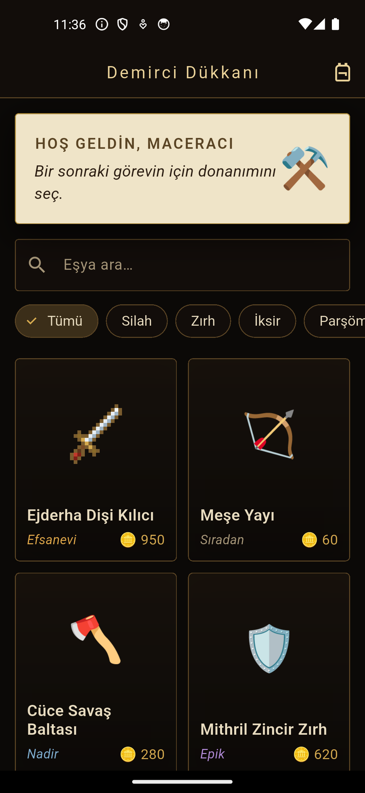
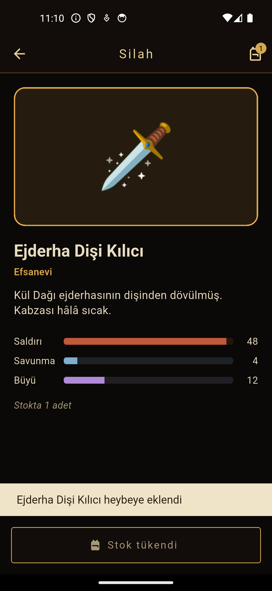
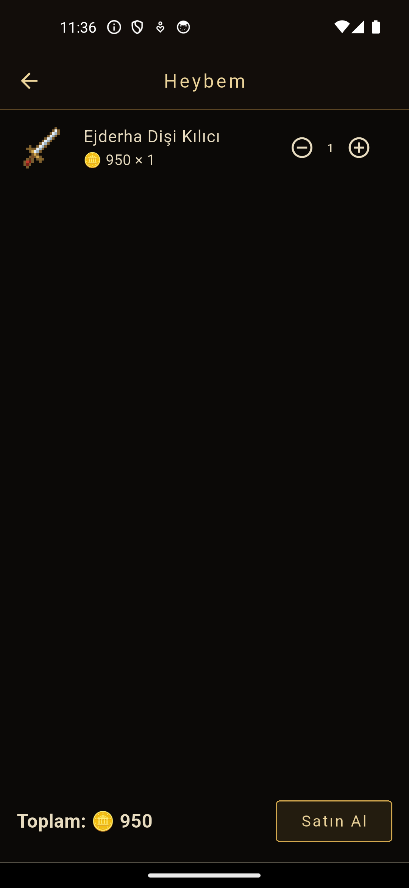

# ⚒️ Lonca — Demirci Dükkanı

Fantastik bir maceracılar loncasının demirci dükkanı için Flutter ile geliştirilmiş **mini katalog uygulaması**.
Maceracılar silah, zırh, iksir, parşömen ve takıları inceler, detaylarına bakar ve heybelerine (sepet) ekler.

## Ekran Görüntüleri

| Ana Sayfa | Eşya Detayı | Heybe |
|---|---|---|
|  |  |  |

## Özellikler

- Banner'lı ana sayfa ve **GridView** ile eşya kartları
- İsimle **arama** ve türe göre **filtreleme**
- **Named routes** + **route arguments** ile detay sayfasına geçiş
- Nadirliğe göre renklendirilmiş kartlar ve stat çubukları
- **Heybe (sepet)**: ekleme/çıkarma, stok sınırı, toplam altın — `ChangeNotifier` ile basit state yönetimi
- Veriler `assets/data/items.json` dosyasından okunur (**fromJson / toJson** model sınıfı)
- **Image.asset** ile piksel sanatı eşya görselleri (`assets/images/`); görseli olmayan eşyalarda emoji gösterilir
- Ekstra paket kullanılmamıştır (yalnızca `material.dart`)

## Kullanılan Flutter Sürümü

Flutter 3.47.7 (stable) • Dart 3.13.5

## Çalıştırma Adımları

```bash
git clone https://github.com/dckaratas/lonca-mobile.git
cd lonca-mobile
flutter pub get
flutter run
```

Android Emulator veya fiziksel bir Android cihaz bağlı olmalıdır.

## Klasör Yapısı

```
lib/
├── main.dart              # Uygulama ve route eşlemeleri
├── routes.dart            # Route isimleri
├── theme.dart             # Renk paleti ve tema
├── models/item.dart       # Eşya modeli (fromJson / toJson)
├── data/
│   ├── item_repository.dart  # JSON'dan veri okuma
│   └── bag.dart           # Heybe state'i
├── pages/                 # home_page, item_detail_page, bag_page
└── widgets/               # item_card, item_image, bag_button
assets/
├── data/items.json        # Eşya verileri
└── images/                # Eşya görselleri
```
